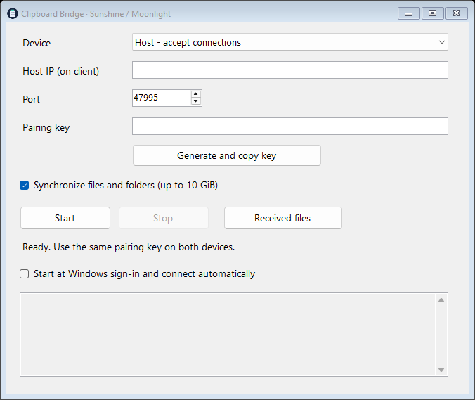

# Clipboard Bridge for Sunshine / Moonlight

A standalone Windows clipboard companion that shares **plain text, images/screenshots, files, and folders in both directions** between two PCs on a local network. Copy on one PC and paste on the other using **Ctrl+C / Ctrl+V**, including in the remote desktop streamed through Moonlight.

This is an **experimental community workaround**, independent of the Sunshine and Moonlight projects. It runs alongside your existing installations and requires no modifications to either project. It is not an official plugin, an RDP implementation, or a replacement for native clipboard support.

## Download

Open [Releases](https://github.com/Eypsilon312/sunshine-moonlight-clipboard-bridge/releases) and download **ClipboardBridge-v0.1.0-beta.3-Windows.zip** from the release assets. GitHub's automatically generated source-code archives do not contain the executable.

Windows 10 / 11 with **.NET Framework 4.8** is required. No installation or .NET SDK is needed. The executable is unsigned; Windows may show a SmartScreen notice.



## Quick start

1. Extract the Windows ZIP to a permanent folder on **both PCs**, then run `ClipboardBridge.exe`.
2. On the Sunshine PC, choose **Host - accept connections**.
3. Click **Generate and copy key**. Transfer the key through a trusted channel and paste it into the **Pairing key** field on the other PC. Treat the key like a password.
4. On the Moonlight PC, choose **Client - connect to host**, enter the host's LAN IP address, and use the same pairing key and port. Use `ipconfig` on the host to find its IPv4 address.
5. Click **Start** on both PCs. If Windows asks, allow the host app through the firewall on **private networks**. Both apps should show **Connected**.
6. Copy something new after connecting. Clipboard contents that existed before the connection are deliberately not sent.

Settings are saved when you click **Start**. The pairing key is protected on disk using Windows DPAPI for the current Windows user. Do not copy `settings.dat` between PCs; configure each PC separately.

## Copy and paste

| Direction | Copy | Paste |
| --- | --- | --- |
| Client to host | Copy in a local client app or Explorer | Switch to the streamed host app or Explorer and press Ctrl+V |
| Host to client | Copy inside the streamed host desktop | Switch to a local client app or Explorer and press Ctrl+V |

For **files and folders**, wait until the receiving app shows **Files received - ready for Ctrl+V in Explorer**, then open the desired destination folder and paste. Explorer chooses the destination; the companion does not need to detect your currently open folder.

For **text**, wait for **Text received - ready for Ctrl+V**, then paste into the target app. Clipboard changes normally appear quickly, but pasting before synchronization finishes can insert the previous clipboard contents.

For **screenshots and clipboard images**, take a screenshot with **Win+Shift+S** or copy an image in an application. Wait for **Image received - ready for Ctrl+V** on the other PC, then paste into an image-capable application such as Paint, a document editor, or a chat app. Images are transferred losslessly as PNG and restored as a standard Windows clipboard bitmap. No image file is staged in the received-files folder. This does not create a file when you paste into Explorer; save the image from an image-capable app if you need a file. File copies from Explorer remain file transfers.

Update **both PCs to beta 3 or later** for image sharing. Older versions cannot receive image-transfer messages. Clipboard images take priority over text when both formats are present; Explorer file lists take priority over images.

Minimize the app to keep it in the system tray. Double-click the tray icon to reopen it. **Stop** pauses synchronization. Closing the window or choosing **Exit** from the tray menu exits the app. Synchronization remains active independently of Moonlight sessions while both companion apps are running.

## Start with Windows and reconnect

After configuring both PCs, enable **Start at Windows sign-in and connect automatically** on each PC. The app starts minimized and connects automatically after the current user signs in. Administrator rights are not needed. Uncheck the option to remove its startup entry.

If the host reboots, the client continues retrying. Once Windows sign-in has started the host app again, the connection is restored automatically. Retry delays are about two seconds plus up to five seconds per failed connection attempt. A silent network outage can take up to approximately 45 seconds to detect.

Startup occurs **after Windows sign-in**, not before login. A normal manual launch loads saved settings; click **Start** to connect. If you move the EXE, launch it from its new permanent location and click **Start** to update its startup path.

An interrupted file transfer is discarded and is not resumed. Copy the files again after reconnection. Clipboard changes made while disconnected are not replayed.

## File behavior and limitations

- Files are fully transferred and staged before pasting becomes available. This differs from RDP's on-demand file transfer. Large transfers take time; wait for the receiving app's ready status.
- Received files are staged in `%LOCALAPPDATA%\ClipboardBridge\Received`, in a separate folder per transfer. Open them using **Received files**. Explorer copies them into your chosen destination when you paste. The app checks at startup and every minute and removes transfer folders older than **three hours**. Files still referenced by the current clipboard or an outgoing transfer are retained until no longer in use. Busy files are retried later. Cleanup runs only while the app is open; it never deletes your source files or copies in your chosen destination folder.
- Allow enough free disk space for the temporary ZIP on each PC, the extracted files on the receiving PC, and the final destination copy.
- Each transfer is limited to **10 GiB**, including the archive, and **100,000 archive entries**. Files are packaged without compression. Unicode names and empty folders are supported.
- Symbolic links, junctions/reparse points, drive roots, and selections with duplicate top-level names are rejected.
- Plain text, Windows bitmap clipboard images/screenshots, and Explorer file-drop lists are supported. Rich text/HTML formatting, virtual files, and Outlook attachments are not supported. Images are limited to **32 MiB of PNG data**, **40 megapixels**, and **16,384 pixels per side**. Image sharing remains enabled when file/folder sharing is unchecked.
- Use **Copy**, not Cut: transfers behave as copies and never delete the source.
- If you copy something locally while files are being received, your newer clipboard is preserved. The received files remain available through **Received files**.
- Simultaneous copying on both PCs can conflict; copy the intended selection again. Received clipboard contents are not automatically sent back.
- The first beta has automated protocol and archive tests, but the full workflow with two physical PCs and Moonlight has not yet been verified in the development environment. Feedback from real setups is welcome.

## Networking and security

The default port is **TCP 47995**. Only the host listens; the client initiates the connection. The app does not automatically create firewall rules or router port forwarding. Use it on a trusted LAN; do not expose this port to the internet.

If Windows does not show a firewall prompt, add a scoped rule on the host in an administrator PowerShell, adjusting the path:

```powershell
New-NetFirewallRule -DisplayName 'Clipboard Bridge LAN' -Direction Inbound -Action Allow -Protocol TCP -LocalPort 47995 -Program 'C:\Apps\ClipboardBridge\ClipboardBridge.exe' -Profile Private -RemoteAddress LocalSubnet
```

Both PCs must be reachable from one another. Guest Wi-Fi with client isolation will prevent connection. For a custom port, update the firewall rule accordingly. A DHCP reservation for the host helps keep its LAN IP stable.

The app generates a random 32-byte shared pairing key. A mutually authenticated nonce exchange derives per-session keys. Frames use AES-256-CBC with random IVs and HMAC-SHA256 authentication of message direction, counters, and ciphertext. Tampering and replayed counters are rejected. **This custom protocol has not had an external security audit and does not provide forward secrecy.** Clipboard contents are shared whenever synchronization is active, including text copied outside a Moonlight session. Stop synchronization when you do not want to share clipboard contents.

Local settings are stored in `%LOCALAPPDATA%\ClipboardBridge\settings.dat` using Windows DPAPI. Startup is registered in `HKCU\Software\Microsoft\Windows\CurrentVersion\Run` as `ClipboardBridge`.

## Build and test

Run these commands in PowerShell from the project folder:

```powershell
.\build.ps1
.\test.ps1
.\package.ps1
```

The build uses the Windows .NET Framework C# compiler, with no external packages. The icon is generated from drawing code by `create-icon.ps1` and embedded in the EXE in multiple sizes. The package script builds, runs the self-test, and creates a versioned Windows ZIP and `SHA256SUMS.txt` in `dist`.

Tests cover authenticated encrypted text in both directions and multipart binary transfer over TCP loopback, Unicode, wrong keys, tampering, replay, file/folder round trips, unsafe archive paths, duplicate entries, packing cancellation, DPAPI settings round trips and replacement, startup-command quoting, three-hour cache expiry, and multipart PNG transfer in both directions with pixel fidelity and invalid/truncated image rejection. Tests do not change your actual startup entry or clipboard. Screenshot capture and pasting into real apps on two physical PCs still require the manual verification checklist.

For a manual verification checklist, see [TESTING.md](TESTING.md). For GitHub publishing and a community announcement draft, see [PUBLISHING.md](PUBLISHING.md).

## Feedback and contributions

Please use [GitHub Issues](https://github.com/Eypsilon312/sunshine-moonlight-clipboard-bridge/issues). Include Windows versions, which direction you copied, whether the clipboard contained text or files, and the visible status/error. Never include your pairing key or private clipboard contents. Bug reports and pull requests are welcome.

Licensed under [MIT](LICENSE). Sunshine and Moonlight are separate projects; their names identify compatibility and do not imply endorsement.
